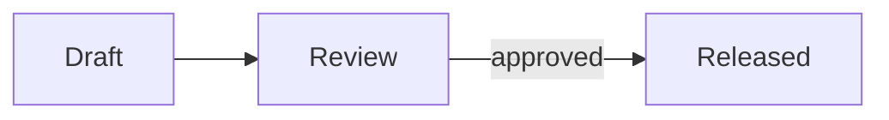
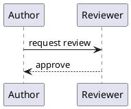

# obs capabilities

<!-- Generated from spec/capabilities by obs.authoring_skill; do not edit. Regenerate: uv run python -m obs.authoring_skill --notes spec/capabilities --coverage spec/capabilities/coverage.json --destination skills/obs-authoring -->

## attachments

Link or embed vault-local source attachments.

**How to write it:** Use a relative Markdown link or a supported attachment embed.

Builds on [markdown](#markdown), [embeds](#embeds).

Example:

```markdown

```

The file `input/data.csv`:

```csv input/data.csv
value
1
```

## bases

Define declarative Base views over canonical note records.

**How to write it:** Use a base fence or embed a YAML .base file in a note.

Builds on [markdown-frontmatter](#markdown-frontmatter), [queries](#queries).

Example:

````markdown
```base
filters: 'kind == "item"'
views:
  - type: table
    order: [file.name]
```
````

## callouts

Mark block content with typed, data-only callouts.

**How to write it:** Start a blockquote with an Obsidian callout marker such as [!warning].

Builds on [markdown](#markdown).

Example:

```markdown
> [!warning] Check the limits
```

## cards-metrics

Author data-only cards and query-backed document metrics.

**How to write it:** Use a cards fence with bounded card and metric mappings.

Builds on [markdown-frontmatter](#markdown-frontmatter), [queries](#queries).

Example:

````markdown
```cards
{"version": 1, "cards": [{"title": "Coverage", "body": "Current state."}]}
```
````

## chapter-inclusion

Include and navigate source notes through manifest and query references.

**How to write it:** Link notes from the manifest and from supported authored references.

Builds on [manifest](#manifest), [wikilinks](#wikilinks), [queries](#queries).

Example:

```markdown
- [[chapter]]
```

## command-fences

Request authorized command-derived document content.

**How to write it:** Use a cmd fence and run it only through the explicit execution boundary.

Builds on [markdown](#markdown).

Example:

````markdown
```cmd
echo Derived content
```
````

## count-query

Compute one declared count from canonical records.

**How to write it:** Declare a count query with its supported source and predicate fields.

Builds on [queries](#queries).

Example:

```markdown
query:
  where: [{field: mark.open_point, exists: true}]
  distinct: mark.open_point
```

## embeds

Embed supported note and Base content in authored Markdown.

**How to write it:** Use a supported exclamation-prefixed wiki embed.

Builds on [wikilinks](#wikilinks).

Example:

```markdown
![[shared-note]]
```

## equation-figures

Plot symbolic equations whose variables move live within their ranges, solved once by the core.

**How to write it:** Write a figure fence of kind equations with SymPy equations, their variables (quantity notes or own defaults, ranges and units) and the initial plot.

Builds on [figures](#figures), [quantities](#quantities).

Example:

````markdown
```figure
version: 1
kind: equations
caption: Engine torque over speed for three throttle positions.
content:
  equations: T = T_max*throttle*(1 - (n/n_max)**2)
  variables:
    n: "[[engineSpeed]]"
    n_max: {default: 6000, unit: rpm}
    T_max: {default: 250, unit: N*m}
    throttle: {default: 1, range: [0, 1]}
    T: {unit: N*m}
  plot:
    x: n
    y: T
    family: {variable: throttle, values: [0.25, 0.5, 1]}
```
^torque
````

The file `engine-speed.md`:

```text engine-speed.md
---
kind: quantity
value: 3000
unit: rpm
range: [800, 6000]
aliases: [engineSpeed]
source: "[[example]]"
---
# Engine speed
```

## extensions

Add a bounded next Obsidian syntax extension.

**How to write it:** Use only an extension with an explicit input-model contract.

Builds on [markdown](#markdown).

Example:

```markdown
> [!note] A callout uses the callouts capability, not extensions.
```

## figure-descriptor

Describe neutral multi-panel figure data and provenance.

**How to write it:** Produce a schema-valid FigureDescriptor with panel geometry, axes, and provenance, and show it as a figure of kind plot.

Example:

````markdown
```figure
version: 1
kind: plot
caption: Measured response over time.
content: {
  "schemaVersion": 1,
  "id": "response",
  "data": {"traces": [
    {"x": [0, 1, 2], "y": [0, 1, 4], "label": "measured", "mode": "lines+markers"},
    {"x": [0, 1, 2], "y": [0, 1.2, 3.8], "label": "model", "color": "#d62728"}
  ]},
  "panels": [{
    "id": "overview",
    "bounds": {"x": 0, "y": 0, "width": 720, "height": 320},
    "grid": {"row": 0, "column": 0, "rowSpan": 1, "columnSpan": 1},
    "axes": [
      {"id": "time", "scale": "linear", "limits": {"minimum": 0, "maximum": 2}, "label": "Time"},
      {"id": "response", "scale": "linear", "limits": {"minimum": 0, "maximum": 4}, "label": "Response"}
    ]
  }],
  "provenance": {"command": ["generate-figure"]}
}
```

```figure
version: 1
kind: plot
caption: How requests flow through review.
content: {
  "schemaVersion": 1,
  "id": "review-flow",
  "data": {
    "sankey": {
      "version": 1,
      "nodes": [
        {"id": "open", "label": "Open", "stage": 0},
        {"id": "done", "label": "Done", "stage": 1},
        {"id": "dropped", "label": "Dropped", "stage": 1}
      ],
      "links": [
        {"source": "open", "target": "done", "value": 8},
        {"source": "open", "target": "dropped", "value": 2}
      ]
    },
    "countLabels": {"unit": "requests"}
  },
  "panels": [{
    "id": "flow",
    "bounds": {"x": 0, "y": 0, "width": 720, "height": 320},
    "grid": {"row": 0, "column": 0, "rowSpan": 1, "columnSpan": 1},
    "axes": [{"id": "stage", "scale": "linear", "limits": {"minimum": 0, "maximum": 1}, "label": "Stage"}]
  }],
  "provenance": {"command": ["generate-figure"]}
}
```
````

## figures

Render every figure, whatever its kind, as one generic figure with a shared caption, block id and alternative text.

**How to write it:** Write a figure fence with version 1, a kind, an optional caption and alt, and the kind's content inline under content or from a source file.

Builds on [markdown-frontmatter](#markdown-frontmatter), [queries](#queries).

Example:

````markdown
```figure
version: 1
kind: sankey
caption: How requests flow through review.
source: review-flow.json
countLabels: {unit: requests}
```
^review-flow

```figure
version: 1
kind: image
caption: The inline variant of an image is SVG markup.
content: '<svg xmlns="http://www.w3.org/2000/svg" viewBox="0 0 10 10"><circle cx="5" cy="5" r="4"/></svg>'
```
````

The file `review-flow.json`:

```json review-flow.json
{"version": 1,
 "nodes": [{"id": "open", "label": "Open", "stage": 0}, {"id": "done", "label": "Done", "stage": 1}],
 "links": [{"source": "open", "target": "done", "value": 3}]}
```

## manifest

Define document metadata, ordered chapters, and an optional abstract.

**How to write it:** Start a manifest note with frontmatter and one nested list of local note links.

Builds on [markdown-frontmatter](#markdown-frontmatter), [wikilinks](#wikilinks).

Example:

```markdown
- [[chapter]]
```

## markdown-frontmatter

Add structured metadata to a Markdown note.

**How to write it:** Put one YAML frontmatter mapping at the beginning of a note.

Builds on [markdown](#markdown).

Example:

```markdown
---
aliases: [Short name]
ignored: true
---
```

## markdown

Render standard Markdown chapter content safely.

**How to write it:** Write CommonMark-compatible text, headings, lists, and fenced code.

Example:

```markdown
# Chapter

Ordinary *emphasis*, **strong**, ~~struck~~, `code` and $x^2$ text.

| Column |
|---|
| A **cell** |

> A quotation.
```

## marks

Annotate authored content with stable semantic marks.

**How to write it:** Add the supported mark syntax to the marked paragraph.

Builds on [markdown](#markdown).

Example:

```markdown
Check the limit. #mark/risk/limit
```

## mermaid

Show a Mermaid diagram as a figure, drawn as SVG when the document is built.

**How to write it:** Write a mermaid fence, as Obsidian renders it, or a figure fence of kind mermaid with a caption and the diagram inline under content or from a .mmd source file.

Builds on [figures](#figures).

Example:

````markdown


```figure
version: 1
kind: mermaid
caption: The review flow, from its file.
source: review-flow.mmd
```
^review-flow
````

The file `review-flow.mmd`:

```text review-flow.mmd
graph TD
  Open --> Done
```

## plantuml

Show a PlantUML diagram as a figure, drawn as SVG when the document is built, without a server.

**How to write it:** Write a plantuml fence, or a figure fence of kind plantuml with a caption and the diagram inline under content or from a .puml source file.

Builds on [figures](#figures).

Example:

````markdown


```figure
version: 1
kind: plantuml
caption: The release sequence.
content: |
  @startuml
  Release -> Archive : store
  @enduml
```
^release-sequence
````

## profiles

Select constrained note and artifact presentation profiles.

**How to write it:** Declare the core obs profile mapping in frontmatter.

Builds on [markdown-frontmatter](#markdown-frontmatter).

Example:

```markdown
---
obs: {document: false}
---
```

## property-editors

Opt one existing frontmatter string field of a note into plain-text editing.

**How to write it:** Write a property-editor fence with version 1, the field and a label.

Builds on [markdown-frontmatter](#markdown-frontmatter).

Example:

````markdown
---
explanation: Original
---
```property-editor
version: 1
field: explanation
label: Review explanation
```
````

Example:

````markdown
---
explanation: Original
status: explained
---
```property-editor
version: 1
field: explanation
label: Review explanation
projection:
  blank: {status: finding}
  nonblank: {status: explained}
```
````

## pugh-decisions

Decide between options as a Pugh matrix whose bottom line, matrix and weight sensitivity a reader sees as one figure.

**How to write it:** Write a pugh fence holding one decision matrix in YAML, with an optional chosen option, each option's sentence, wins and losses, and a checklist.

Builds on [figures](#figures).

Example:

````markdown
```pugh
title: Which message queue
chosen: managed
context: a team of three running its own servers
concern: the queue's upkeep
criteria:
  - {key: latency, label: p99 latency (ms), weight: 3, better: lower, tolerance: 0.2, floor: 1}
  - {key: ops, label: Ease of operation, weight: 2, better: higher, kind: judged}
candidates:
  - {key: current, label: Current queue, what: The queue we run today., values: {latency: 12},
     wins: Nothing to migrate.}
  - {key: managed, label: Managed queue, short: Managed, what: A hosted queue we rent., values: {latency: 14},
     marks: {ops: {mark: [2, 1, 2], because: the vendor runs it}}, wins: No servers to run., losses: A bill every month.,
     success: The on-call log shows no queue incident for a quarter.}
gates:
  - {criterion: latency, maxRatio: 2, why: fails the main job}
datum: {prefer: [current]}
checklist:
  - {item: "Can we leave it within a month?", answer: Not the managed one., pass: false, options: [B]}
```
````

## quantities

Express named numeric values and their canonical sources.

**How to write it:** Author a quantity note with its supported numeric frontmatter.

Builds on [queries](#queries), [markdown-frontmatter](#markdown-frontmatter).

Example:

```markdown
---
kind: quantity
value: 42
unit: kN
aliases: [maxLoad]
source: "[[load-calculation]]"
---
```

## queries

Define reusable, declarative selections and aggregates.

**How to write it:** Give a supported query mapping a stable name and reference that name.

Builds on [markdown-frontmatter](#markdown-frontmatter).

Example:

```markdown
query:
  where: [{field: status, equals: open}]
```

## references

Resolve reference notes, labels, and external source links.

**How to write it:** Use a reference note and supported link text rather than raw external prose links.

Builds on [wikilinks](#wikilinks), [markdown-frontmatter](#markdown-frontmatter).

Example:

```markdown
---
kind: glossary
term: Datum
definition: A reference.
---
```

## registers

Reuse authored table views as named registers.

**How to write it:** Embed a named view from a .base file with a Base embed link.

Builds on [bases](#bases).

Example:

```markdown
![[registers.base#Open points]]
```

The file `registers.base`:

```yaml registers.base
views:
  - type: table
    name: Open points
    filters: 'status == "open"'
    order: [file.name]
```

## wikilinks

Resolve local Markdown and Obsidian note links.

**How to write it:** Link a vault note with a Markdown link or a double-bracket wikilink.

Builds on [markdown](#markdown).

Example:

```markdown
See [[chapter#Details]].
```
