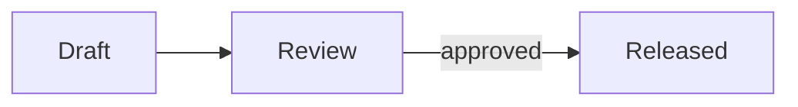

## What it does

A `mermaid` fence is a figure of kind `mermaid` ([[capabilities/figures]]), as Obsidian shows
it. A `figure` fence of kind `mermaid` adds a caption, `alt` and a block id, and takes the
diagram inline under `content` or from `source`, a `.mmd` file relative to the note.

The core draws the diagram as SVG while it builds the Document, on the build machine and
without the network, with the Mermaid library pinned in the core's diagram renderers. The
figure's body carries both the diagram's text, for review, and the SVG, so every output shows
the same picture and none needs Mermaid. A diagram Mermaid cannot read, or a build without the
renderers installed, is an input error that names the note, its line and the remedy: Mermaid's
own message, or the command that installs the renderers
([[input-model#Remaining chapter content]], Figure input direction).

A `click <node> href "note"` line links a node to a note like a prose link
([[capabilities/wikilinks#Links inside a figure]]).

## Authoring example

````markdown


```figure
version: 1
kind: mermaid
caption: The review flow, from its file.
source: review-flow.mmd
```
^review-flow
````

The figure's diagram file:

```text review-flow.mmd
graph TD
  Open --> Done
```
