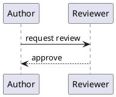

## What it does

A `plantuml` fence is a figure of kind `plantuml` ([[capabilities/figures]]). A `figure` fence
of kind `plantuml` adds a caption, `alt` and a block id, and takes the diagram inline under
`content` or from `source`, a `.puml` file relative to the note.

The core draws the diagram as SVG while it builds the Document, on the build machine and never
through a PlantUML server, with PlantUML's JavaScript build pinned in the core's diagram
renderers; no Java runtime is needed. The figure's body carries both the diagram's text, for
review, and the SVG, so every output shows the same picture. A diagram PlantUML cannot read, or
a build without the renderers installed, is an input error that names the note, its line and
the remedy: PlantUML's own message, or the command that installs the renderers
([[input-model#Remaining chapter content]], Figure input direction). A diagram includes no
other file and no standard-library sprite: the renderer reads nothing but the diagram.

A `[[note]]` link on an element links it to a note like a prose link
([[capabilities/wikilinks#Links inside a figure]]).

## Authoring example

````markdown


```figure
version: 1
kind: plantuml
caption: The release sequence.
content: |
  @startuml
  Release -> Archive : store
  @enduml
```
^release-sequence
````
